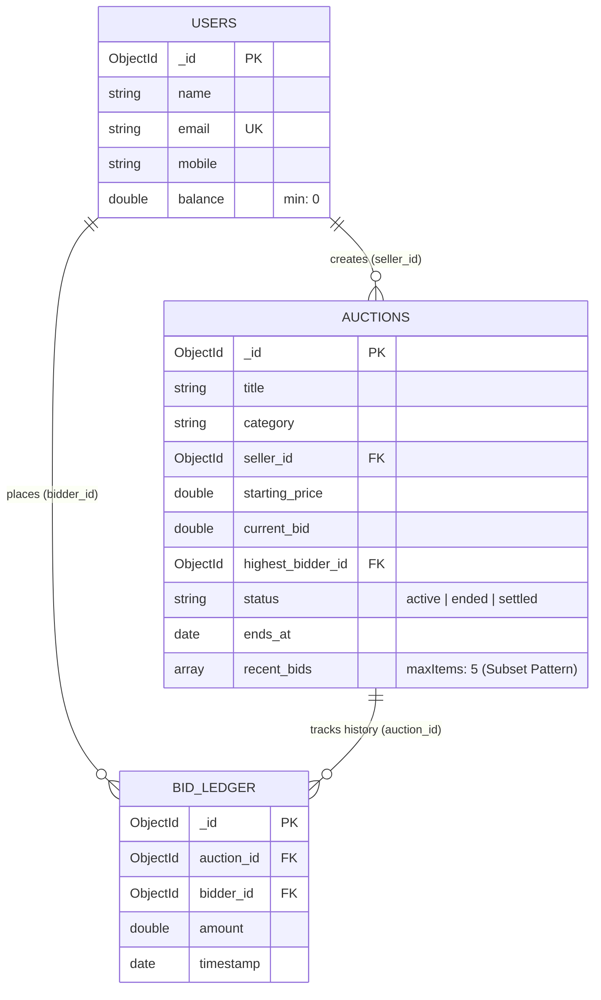

# ApexBid ⚡
### High-Concurrency Anti-Sniping Auction Engine with MongoDB & Python

[](https://www.mongodb.com/)
[](https://www.python.org/)
[](https://pymongo.readthedocs.io/)
[](LICENSE)

---

## 📌 Overview

**ApexBid** is a competitive online auction platform engineered for high-concurrency bidding environments. Unlike standard auction applications that suffer from race conditions or require complex distributed locking layers (e.g., Redis Redlock), ApexBid leverages **native MongoDB atomic document operations** and **schema design patterns** to deliver guaranteed data integrity, sub-millisecond listing lookups, and anti-sniping protection.

Built as an academic and portfolio-grade database systems project, ApexBid demonstrates advanced NoSQL engineering principles using **Python (PyMongo)** and **MongoDB Atlas**.

---

## 🎯 Key Problems Solved

1. **Bid Sniping (Bot Warfare):**
   * *Problem:* Automated bots place bids in the final fraction of a second, preventing legitimate buyers from reacting and shortchanging sellers.
   * *Solution:* **Dynamic Soft-Close Algorithm.** If any valid bid is submitted within the final 2 minutes of an auction, the deadline automatically extends by 3 minutes. The auction concludes only when genuine price discovery is reached.

2. **Concurrency Race Conditions:**
   * *Problem:* When dozens of users click "Bid $100" at the exact same millisecond, naive read-modify-write logic causes duplicate winners, negative wallet balances, and corrupted records.
   * *Solution:* **Lock-Free Atomic Query Guards.** Single-document atomicity (`findOneAndUpdate`) evaluates the current bid and timestamp in an indivisible step. The fastest valid bid succeeds; subsequent stale bids fail immediately with zero dirty reads.

3. **Read Latency & Document Bloat:**
   * *Problem:* Embedding thousands of historical bids inside a single listing exceeds MongoDB's 16MB document boundary and degrades read performance.
   * *Solution:* **The Subset Pattern.** The `auctions` document embeds only the 5 most recent bids for instantaneous page rendering, while an append-only `bid_ledger` stores the exhaustive audit trail.

---

## 🏛️ System Architecture & Data Modeling

ApexBid divides responsibilities across three dedicated collections, balancing **denormalization (for read speed)** and **normalization (for historical compliance)**:



---

## 🔬 Core MongoDB Concepts Demonstrated

| Topic | Implementation Details | Academic / Viva Value |
| :--- | :--- | :--- |
| **Schema Validation (`$jsonSchema`)** | Applied to `users` and `auctions` to enforce strict data types, required fields, and mathematical rules (`balance >= 0`). | Proves data integrity constraints can be maintained natively in NoSQL without ORM dependence. |
| **The Subset Pattern** | Embedded `recent_bids` array capped at 5 elements using `$slice: -5`. | Demonstrates access pattern optimization, sub-millisecond lookups, and avoiding the 16MB BSON limit. |
| **Atomic Conditional Updates** | `findOneAndUpdate` with query-level filters (`current_bid < new_bid`, `ends_at > now`). | Eliminates race conditions at the storage engine level without database-level table locks. |
| **Compound & Text Indexing** | Compound index on `[("status", 1), ("ends_at", 1)]` (ESR Rule); Text index on `title`. | Prevents full collection scans (`COLLSCAN`), ensuring index scans (`IXSCAN`) for sorting and search. |
| **Aggregation Pipelines** | `$match`, `$group`, and `$facet` stages computing average sale prices and category distribution. | Replaces complex SQL `JOIN` and `GROUP BY` operations with optimized server-side analytical pipelines. |

---

## 📂 Project Structure

```text
ApexBid/
├── .env                  # Private MongoDB Atlas connection URI
├── .env.example          # Template environment file
├── requirements.txt      # Python dependencies (pymongo, python-dotenv)
├── README.md             # Project documentation & architecture reference
│
├── 1_setup_schema.py     # [Phase 1] Database initialization, JSON schemas & indexes
├── 2_seed_data.py        # [Phase 2] Mock dataset generation (users & active auctions)
├── 3_bidding_engine.py   # [Phase 3 & 4] Atomic bidding logic, anti-sniping & subset updates
├── 4_analytics.py        # [Phase 5] Aggregation pipeline for market insights
└── 5_concurrency_test.py # [Bonus] Multi-threaded simulation testing race condition safety
```

---

## 🚀 Getting Started

### 1. Prerequisites
* Python 3.10+
* Free MongoDB Atlas Cluster (or local MongoDB 6.0+ instance)

### 2. Installation & Setup
```bash
# Clone the repository
git clone https://github.com/<your-username>/ApexBid.git
cd ApexBid

# Create and activate virtual environment
python3 -m venv venv
source venv/bin/activate  # On Windows: venv\Scripts\activate

# Install dependencies
pip install -r requirements.txt
```

### 3. Configure Environment Variables
Copy the template and configure your connection string:
```bash
cp .env.example .env
```
Inside `.env`:
```env
MONGO_URI=mongodb+srv://<username>:<dbpassword>@apexbid.pky5arf.mongodb.net/?appName=ApexBid
```

### 4. Sequential Execution

Execute the modules in order to observe the lifecycle:

```bash
# Step 1: Initialize collections, schemas, and indexes
python setup_schema.py

# Step 2: Populate with realistic mock users and listings
python seed_data.py

# Step 3: Run the atomic bidding engine demo
python bidding_engine.py

# Step 4: Run the market analytics aggregation pipeline
python analytics.py

# Step 5: Run the formal Pytest suite (12 automated tests)
pytest -v

# Step 6: Generate test code coverage report
pytest --cov=bidding_engine --cov=analytics --cov-report=term-missing

# Step 7: Launch the interactive Streamlit web dashboard
streamlit run app.py
```

---

## 🎓 Defense Quick Reference

**Q1: Why choose MongoDB over a Relational Database (PostgreSQL/MySQL) for an auction system?**  
> **Answer:** Auctions demand extremely low read latency during closing countdowns. In relational models, fetching an auction with its seller profile, category metadata, and latest bids requires multi-table `JOIN` operations. MongoDB allows us to embed the latest bids directly inside the document (the Subset Pattern), serving full listing states in a single disk read.

**Q2: How does ApexBid solve race conditions without using Redis or database table locks?**  
> **Answer:** We rely on MongoDB's single-document write atomicity using `findOneAndUpdate`. By embedding filter conditions directly into the update query (`{ current_bid: { $lt: new_bid }, ends_at: { $gt: now } }`), MongoDB serializes concurrent writes at the document level. If 20 users submit a bid at the exact same millisecond, the first valid bid updates the document and all remaining 19 queries fail gracefully.

**Q3: What happens if an auction receives 50,000 bids? Does the document exceed 16MB?**  
> **Answer:** No. We implemented the Subset Pattern. Using the `$slice: -5` modifier within `$push`, the `recent_bids` array never exceeds 5 items. The remaining historical bids are asynchronously written to the append-only `bid_ledger` collection.

**Q4: Explain the purpose of the compound index `[("status", 1), ("ends_at", 1)]`.**  
> **Answer:** It adheres to MongoDB's **ESR (Equality, Sort, Range)** indexing rule. The primary access pattern is finding `status: "active"` (Equality) sorted by `ends_at: 1` (Sort). The index allows MongoDB to avoid an in-memory `SORT` and full collection scan (`COLLSCAN`), resolving queries directly via an Index Scan (`IXSCAN`).

---

## 📄 License
This project is open-source under the [MIT License](LICENSE).
